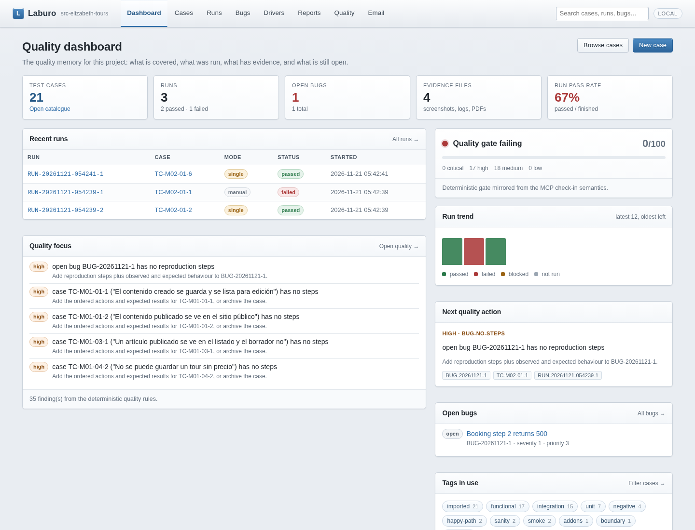
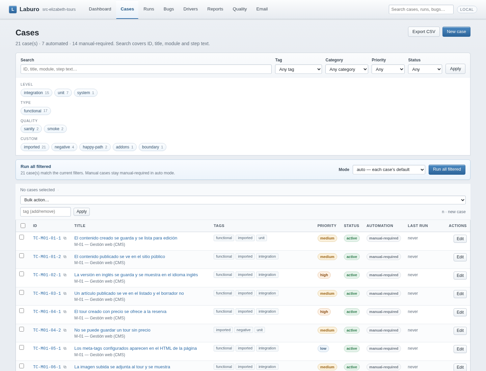
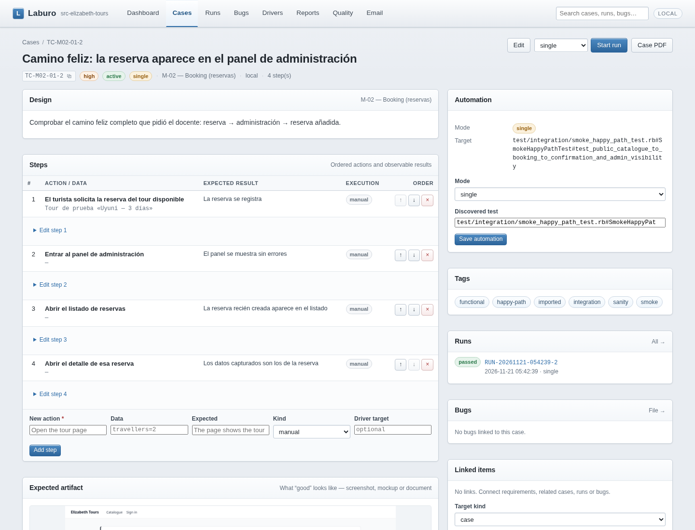
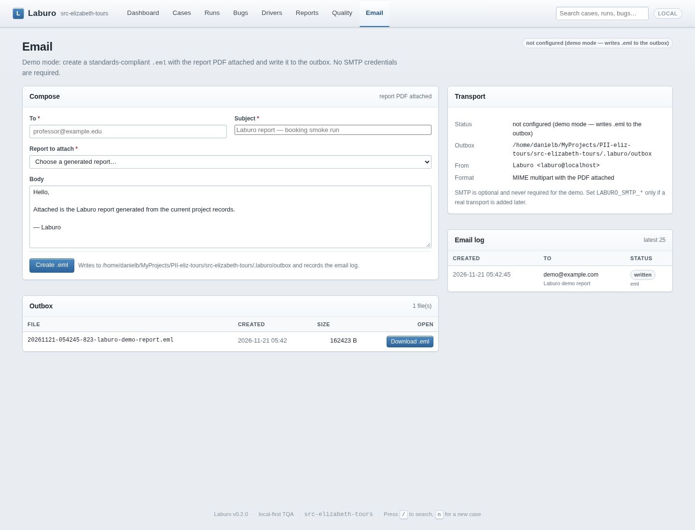
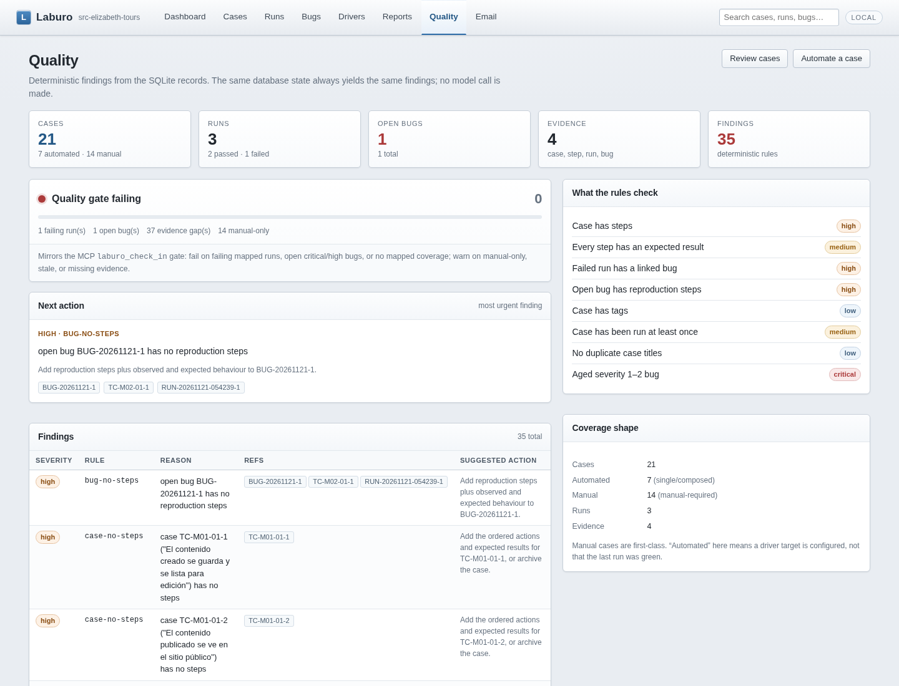

# Laburo

A local-first TQA suite for a solo developer working with AI.

Laburo manages test cases and runs, executes manual and Minitest-backed tests,
records expected/actual evidence, files bug reports, exports class-format Typst
PDFs, and exposes a quality gate over MCP so a coding swarm can ask “are we
doing this right, and with quality?”. The web UI is the human surface; the CLI
is the core/CI surface; MCP is the AI surface.

> **Status: v0.2 (Demo Edition) complete.** P0 is verified: 83 Laburo tests,
> 71 Rails tests + 1 system test, web/email/MCP/PDF flows, installed binary.
> The author still records the 15-minute video and publishes the repo link.
> See [`GOAL-v0.2.md`](GOAL-v0.2.md), [`DEMO.md`](DEMO.md), and
> [`docs/status.md`](docs/status.md).

## Screenshots

From the seeded `src-elizabeth-tours` demo:



| Cases | Case detail |
|---|---|
|  |  |

| Email outbox | Quality |
|---|---|
|  |  |

## Demo

```bash
cargo install --path . --locked
./scripts/demo-seed.sh          # resets only src-elizabeth-tours/.laburo
laburo web --port 3000
```

Open <http://127.0.0.1:3000>. The 15-minute script and shot list are in
[`DEMO.md`](DEMO.md).

## Install

```bash
cd laburo
cargo install --path . --locked
laburo doctor
```

## Quick start

```bash
make install
./scripts/demo-seed.sh
laburo web --port 3000
laburo case list --tag smoke
laburo run batch --tag smoke --mode auto
laburo report dictionary
laburo email send --to demo@example.com --subject "TQA report" --report <pdf>
laburo mcp
```

## MCP quality contract (for coding swarms)

A coding agent should check in with Laburo before and after a change:

1. `laburo_check_in` with a feature, case, or tag: relevant cases, mapped/
   unmapped coverage, last results, evidence gaps, open bugs, next actions, and
   `pass`/`warn`/`fail`.
2. Run the mapped cases; record evidence/artifacts.
3. File a bug on failure, linked to the reproducing case and run.
4. Re-run the check-in until it is `pass` or the remaining warnings are known.

The seeded demo starts at **fail 40**; after the smoke batch and closing the
bug the same check-in returns **pass 100**. The AI orchestrates; Laburo
remembers the quality truth. No model call is required for the gate.

## Development

```bash
make test                    # cargo test --all-targets
make test-fast               # cargo nextest run --all-targets
make e2e                     # fixture flow: driver + four PDFs + MCP
scripts/pod.sh tui check     # per-pod target dir + sccache, for parallel agents
```

## Documentation

- [`GOAL-v0.2.md`](GOAL-v0.2.md) — current objective, scope, verification.
- [`DEMO.md`](DEMO.md) — 15-minute walkthrough, shot list, reset.
- [`docs/v0.2-contracts.md`](docs/v0.2-contracts.md) — frozen schema, routes, APIs.
- [`docs/architecture.md`](docs/architecture.md) — components and boundaries.
- [`docs/data-model.md`](docs/data-model.md) — SQLite schema.
- [`docs/execution-model.md`](docs/execution-model.md) — manual, single, composed.
- [`docs/drivers.md`](docs/drivers.md) — manual, Minitest, nextest.
- [`docs/reports.md`](docs/reports.md) — Typst projections and templates.
- [`docs/tui.md`](docs/tui.md) — layout and keymap.
- [`docs/ai.md`](docs/ai.md) — quality engine / AI boundary.
- [`docs/mcp.md`](docs/mcp.md) — agent automation surface.
- [`docs/install.md`](docs/install.md) — runtime dirs, config, backup.
- [`docs/use-cases.md`](docs/use-cases.md) — Tier 1 and Tier 2 use cases.
- [`docs/status.md`](docs/status.md) — live board.

## Principles

- SQLite is the only source of truth. JSON only as a transient report projection;
  no YAML in Laburo.
- Typst is invoked as a CLI; no Typst crate.
- The library owns behavior; web/CLI/TUI/MCP are thin.
- Evidence is a graph: expected artifact, actual step/run artifacts, entity
  links, optional bug-to-TC/run links.
- Tags, not hard-coded test-type enums.
- Minitest first; cargo-nextest second; Cucumber/Selenium later.
- AI is a quality safeguard through MCP; no model call is required for the gate.

## Provenance

Laburo is its own git repository inside the Elizabeth Tours thesis workspace.
The thesis root ignores `laburo/`. The wiki note is
`ElizToursWiki/Software/Laburo.md`.
